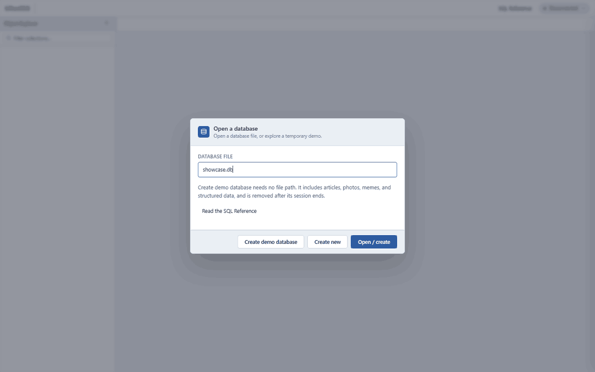
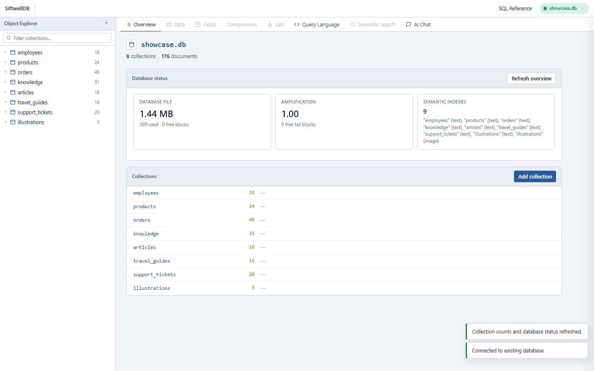
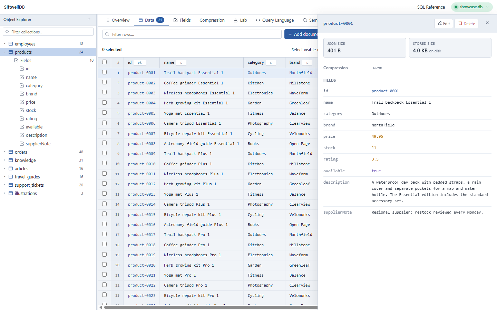
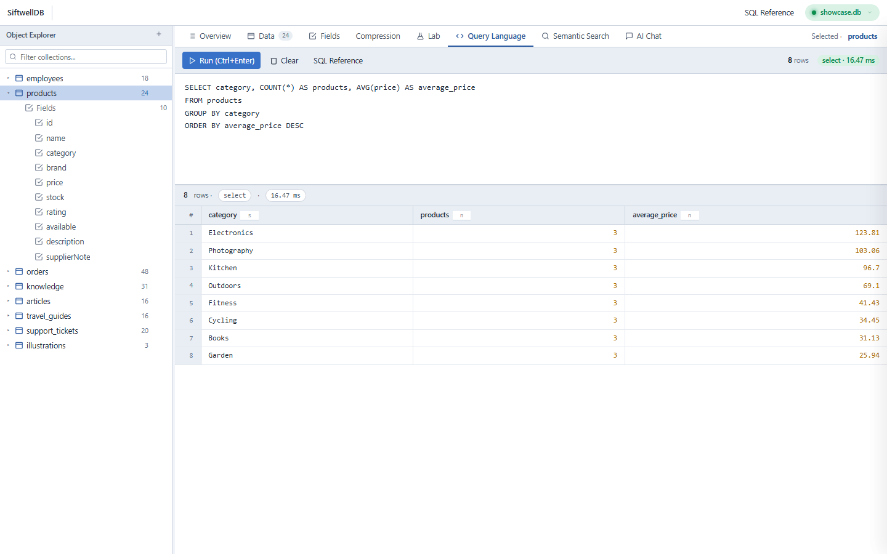
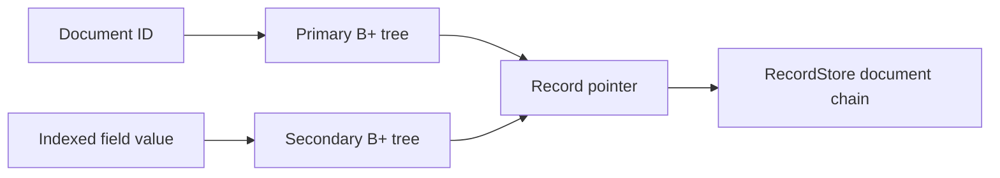
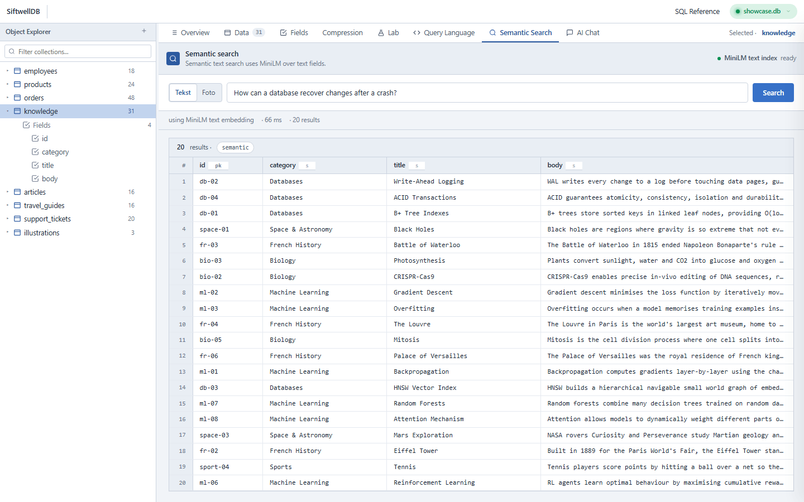
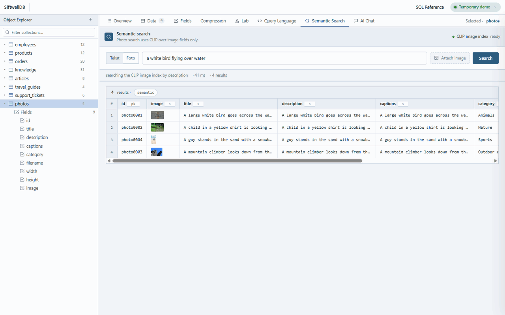
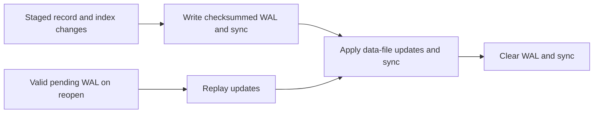
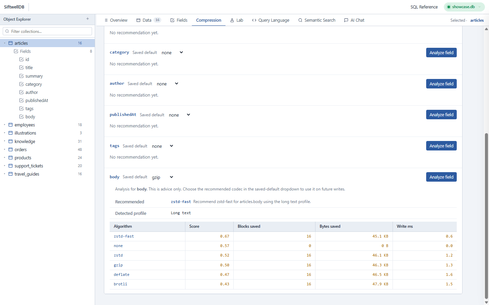
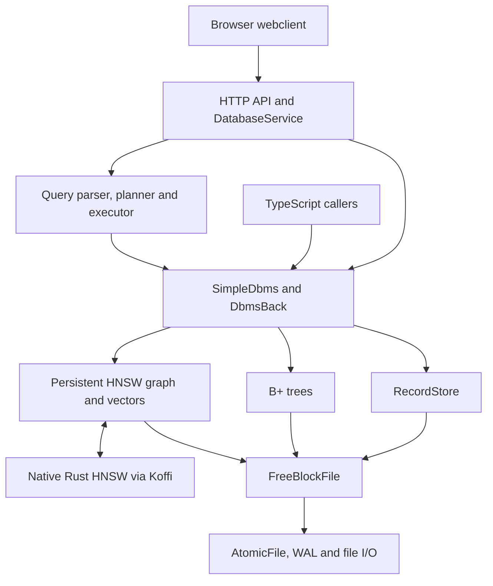

# SiftwellDB

SiftwellDB is a document database written in TypeScript and Node.js, with a Rust implementation of HNSW for semantic
search. It stores documents in a block-based file and uses B+ trees to look them up by ID or field value. The webclient
lets you browse and edit documents, run SQL-like queries, search text and images and manage database storage.

The database implements its own record format, block allocation, indexes and recovery. These components share the same
storage: editing a document updates its indexes, committing writes their changes together and compaction moves blocks
while updating the references between them. The TypeScript API exposes these operations directly.



The captures use small demo databases. The [media guide](docs/media/README.md) describes their contents, photo credits
and how the recordings were made.

[Quick start](#quick-start) · [Documents](#working-with-documents) · [SQL and indexes](#queries-and-indexes) ·
[Semantic search](#semantic-search) · [Demo](#demo-database) · [Storage](#storage-and-persistence) ·
[Maintenance](#compaction-and-vacuum) · [Development](#development-and-verification)

## Quick start

Use **Node.js 24** and npm. The compression code uses Node's Zstandard APIs. From the repository root:

```sh
npm ci
npm run build
npm start
```

Open **[http://localhost:8000](http://localhost:8000)**. The daemon prints that address when it starts. Select a saved
database from the dropdown and click **Open**, or enter a name and click **Create database**. Persistent webclient
databases live in the project's `databases/` folder. The daemon creates this folder and handles the data file, WAL and
optional schema-model sidecar together. Creating a database requires a new name and never replaces an existing one.

**Create demo database** opens temporary sample collections. The demo requires the local image sources described below.

The build compiles server and browser TypeScript and copies the static frontend assets and native libraries. Maintained
HNSW binaries are included for x86-64 Windows and Linux. Rust is needed to rebuild them or provide a library for macOS
or another CPU architecture. The [native build instructions](hnsw-native/README.md) explain how to compile and copy the
library. The npm build copies the supplied binaries; rebuilding Rust is a separate step.

MiniLM and CLIP load on first use and download their model assets if they are not already cached. Once available,
embedding inference runs locally. Normal startup does not need a Gemini key. Only conversational analytics uses Gemini:
configure it through the webclient or copy `.env.example` to `.env` and supply your own key.

For source development, build the browser assets first, then use `npm run start:dev`. Rebuild browser TypeScript after
changing it and restart the daemon after server changes. The [webclient guide](src/webclient/README.md) describes the
controls and operation lifecycle in more detail.

## Working with documents

A database contains named collections. Inserting a collection's first document creates it. Documents are flat objects
with a required `id` and fields containing strings, finite numbers, booleans or binary buffers. General arrays, nested
objects and stored `null` values are not supported.

In the webclient, select a collection in Object Explorer, open **Data** and add a JSON document. The editor can attach
an image field, edit existing values or replace the whole document. Fields and Compression expose the collection's index
and codec settings. Bulk actions operate on selected rows or the entire collection, including unloaded pages, after
confirmation.



The backend commits document writes made through the webclient. Database operations run through a shared queue, so a
large deletion can delay other reads and writes. The interface shows when a request is waiting and refreshes the
collection list when the operation finishes.



### Using the database API

`SimpleDbms` is the main database API. The project is not published as an npm package, so this example imports the
compiled modules. After building, save it as `example.mts` in the repository root and run `npx tsx example.mts`. It uses
a fresh temporary directory so repeating it does not overwrite an existing database.

```typescript
import { mkdtemp } from 'node:fs/promises';
import { tmpdir } from 'node:os';
import path from 'node:path';
import { SimpleDbms } from './build/database/simpledbms.mjs';
import { RealFile } from './build/storage/file.mjs';

const directory = await mkdtemp(path.join(tmpdir(), 'siftwell-example-'));
const dataPath = path.join(directory, 'example.db');
const logPath = `${dataPath}.log`;
const db = await SimpleDbms.create(new RealFile(dataPath), new RealFile(logPath));

try {
  await db.setFieldIndexed('articles', 'body', false);
  db.setFieldCompressionDefaults('articles', { body: 'zstd' });
  await db.insertDocumentObject('articles', {
    id: 1,
    title: 'Building a database',
    category: 'Engineering',
    year: 2026,
    body: 'Storage, indexes and recovery work together. '.repeat(100),
  });
  await db.editDocument('articles', 1, 'title', 'Inside a document database');
  await db.commit();
  console.log(await db.getDocumentObjectById('articles', 1));
} finally {
  await db.close();
}

const reopened = await SimpleDbms.open(new RealFile(dataPath), new RealFile(logPath));
try {
  console.log(await reopened.countDocuments('articles'));
} finally {
  await reopened.close();
}
```

`create()` replaces its destination contents; use `open()` for existing data. Keep the data file and its companion WAL
together. Most direct library mutations and metadata changes require an explicit `commit()`. Closing releases resources
without committing pending changes. Whole-collection `deleteCollection()` commits its deletion itself. Individual
deletion is `deleteDocumentById(collection, id)`.

### Identifier consistency

An ID is a well-formed Unicode string or a finite number. Each collection retains the primary ID type established by its
first document, so numeric `42` and string `"42"` are not interchangeable. Collection and field names are exact,
case-sensitive strings. The metadata collections `__hnsw__`, `__compression__` and `__indexing__` are reserved.

The HTTP API uses JSON-typed query parameters to preserve IDs and unusual names without URL-path normalization. See the
[addressing contract](src/webclient/README.md#exact-document-addresses) and
[stored identity and compatibility rules](docs/storage-and-index-compatibility.md#identifier-consistency).

## Queries and indexes

The **Query Language** tab runs the same SQL-like engine as the command-line tool and `QueryLanguage` library class. It
supports `SELECT`, `INSERT`, `UPDATE`, `DELETE` and `EXPLAIN SELECT`. Selection includes predicates, aliases,
`DISTINCT`, aggregates, `GROUP BY`, `HAVING`, ordering and `LIMIT`/`OFFSET`.

These queries use fields in the demo database. Run each statement separately; multi-statement input is not supported.

```sql
SELECT department, COUNT(*) AS people, AVG(salary) AS average_salary
FROM employees
GROUP BY department
HAVING COUNT(*) >= 5
ORDER BY average_salary DESC;

SELECT name, price
FROM products
WHERE price > 100
ORDER BY price DESC
LIMIT 10;

EXPLAIN SELECT name FROM products WHERE category = 'Outdoors' LIMIT 10;
```



Writes use the document model rather than SQL table definitions:

```sql
INSERT INTO playground VALUES { id: 'guide-1', title: 'Camping pack', quantity: 3 };
UPDATE playground SET quantity = 9 WHERE id = 'guide-1';
DELETE FROM playground WHERE id = 'guide-1';
```

The webclient asks for confirmation before SQL mutations. Direct library callers commit their own SQL writes. The CLI
can open or initialize a database. Pass both paths explicitly, replacing the illustrative `example.db` pair with your
own:

```sh
npm run cli -- --data example.db --log example.db.log "SELECT * FROM articles LIMIT 10"
```

In PowerShell, use `npm.cmd run cli -- ...` so npm forwards the CLI options unchanged. The API example above puts its
files in a fresh OS temporary directory, not the repository root.

This is a deliberately limited query language. It has no joins, subqueries, general arithmetic projections, DDL or
transaction statements. `CONTAINS` is a literal substring predicate. The [SQL reference](src/query/README.md) gives the
grammar, comparison semantics and further examples; the same reference opens beside the webclient editor without an
internet connection.

Every collection has a primary B+ tree mapping IDs to record locations. Ordinary scalar fields also receive secondary
indexes by default. A secondary key combines the field value with the ID, which lets repeated values retain a stable
order. Changing a document updates its existing indexes; disabling a field index removes that tree without removing the
field or document. Enabling one validates and backfills the current data.

Long article bodies are poor B+ tree keys. Disable their indexes before inserting them, as in the API example. Encoded
keys are bounded by the block layout, with a 2,035-byte limit for default 4,096-byte blocks; composite-key overhead
reduces the space available for a field value. Compressing a field does not shorten its index key. Unindexed text
remains stored and available to scans and semantic indexing.

The planner uses an index when it can answer a predicate with an equality lookup or a supported range scan. Other
predicates scan the collection. Numeric secondary ranges currently use that fallback and `ORDER BY` sorts its candidates
in memory. `EXPLAIN SELECT` shows which path a query uses.



For incremental traversal, `fetchPageCursor()` in [`src/database/pagination.mts`](src/database/pagination.mts) returns
JSON strings in `data`, an optional `nextCursor` and `hasMore`. Pass the token unchanged to continue after the full
logical key, including the ID tie-breaker. Tokens survive physical relocation and reopening, but pagination is not a
snapshot: inserts or indexed-value changes can affect later pages. The webclient grid uses offset pagination and sorts
or filters its loaded rows.

## Semantic search

An embedding turns text or an image into a numeric vector. Similar content tends to have nearby vectors, so a
natural-language question can retrieve a document that uses different wording. SiftwellDB stores those vectors alongside
a Hierarchical Navigable Small World graph, or HNSW, which searches for approximate nearest neighbours. The Rust library
performs the graph search and updates; TypeScript coordinates document identity and persistent graph/vector storage.

The webclient uses two separate encoders and index kinds:

| Search                                        | Encoder                        | Vector dimensions |
| --------------------------------------------- | ------------------------------ | ----------------: |
| Text query to text documents                  | `Xenova/all-MiniLM-L6-v2`      |               384 |
| Text query or uploaded image to stored images | `Xenova/clip-vit-base-patch32` |               512 |

Eligible string fields contribute to the text representation independently of their B+ tree settings. Image fields use
the image encoder; MIME sidecars do not contribute text. Documents with long text are not split into chunks, so model
input limits still matter. The default models are aimed at English; other languages are accepted but multilingual
retrieval quality is not assured. See the upstream
[MiniLM](https://huggingface.co/sentence-transformers/all-MiniLM-L6-v2) and
[CLIP](https://huggingface.co/openai/clip-vit-base-patch32) model cards.



In **Semantic Search**, select a collection and use its text mode for documents such as support tickets or articles.
Photo/text-to-image mode embeds the query with CLIP and searches image vectors. Uploading an image performs
image-to-image retrieval. The original image bytes remain ordinary stored document data; the vector is a separate
representation used for matching.

The GIF shows searches in the demo's `photos` collection using a small selection of its photographs. CLIP embeds each
query or uploaded image, then the native HNSW index ranks the stored image vectors. The results and document view display
the photos read from the database.



Photo credits and the recording's licence are listed in the [media guide](docs/media/README.md#hnsw-photo-search).

HNSW returns an approximate ranking by vector similarity. Its graph and vectors are stored in the database file.
Removing a semantic document leaves graph tombstones and retained anchors so navigation remains valid; those entries no
longer appear as live results. Full vacuum rebuilds graphs from live documents and removes the retained tombstone data.
Incremental compaction can relocate it without rebuilding the graph.

Programmatic semantic search requires an `HnswConfig` supplied when creating or opening the database. The webclient
provides that configuration itself. Keep the original encoders and dimensions for a persisted index: equal dimensions
alone do not make different embedding models compatible. [Dimension compatibility](src/indexes/hnsw/README.md) describes
the persisted checks and legacy restrictions.

## Demo database

**Create demo database** generates sample collections in a temporary database. Structured records and longer articles
are generated in code, while photographs and memes come from local files. The seeder inserts them through the database
API, computes their embeddings and builds the B+ tree and HNSW indexes. It then commits and reopens the database before
connecting the webclient.

The default dataset contains **2,055 documents**, including **840 images**, when all required local inputs are
available:

| Collection      | Default count | What to explore                                 |
| --------------- | ------------: | ----------------------------------------------- |
| employees       |           200 | Departments, salaries and SQL aggregates        |
| products        |           160 | Price filters, sorting and descriptions         |
| orders          |           400 | Consistent quantities, totals and status groups |
| knowledge       |            31 | Short semantic text searches                    |
| articles        |           240 | Long text, field indexes and compression        |
| travel_guides   |            64 | Destination descriptions and semantic queries   |
| support_tickets |           120 | Paraphrases, priorities and resolutions         |
| photos          |           450 | Photographs with their supplied captions        |
| gallery         |           150 | Image retrieval without descriptive captions    |
| memes           |           240 | Visual similarity across local templates        |

Local inputs live under `examples/assets/images/photos/`, `gallery/` and `memes/`. The photo folder includes
`captions.json` and the Flickr8k notice. Photos and gallery use different files; gallery documents intentionally omit
caption metadata. The number of imported images depends on the available valid files. Supply these datasets locally
before creating the demo.

`npm run demo:images` uses a separate set of six bundled CC0 photographs directly in `examples/assets/images/`.

Creation can take several minutes, especially during the first model download. The database belongs to the temporary
session and is removed when you disconnect or switch databases. The daemon also removes abandoned demos after their
browser tabs stop renewing the session. The [demo guide](src/webclient/README.md#temporary-demo) explains this
lifecycle.

To keep a copy of the demo, supply the local assets and run `npm run seed:test`. It creates
`databases/webclient-test.db` and its WAL and refuses to overwrite an existing output. Select `webclient-test.db` from
the database dropdown to open it. Smaller standalone
text and image examples remain available through `npm run demo`, `npm run demo:images` and `npm run demo:map`.

## Storage and persistence

The default database uses **4,096-byte blocks**. `FreeBlockFile` manages allocation and reuse of free blocks.
`RecordStore` serializes each document into one or more linked record blocks, while B+ trees and semantic storage use
the same allocator. Deleting a record normally creates reusable space inside the file; it does not necessarily reduce
the file's physical length.

Changes are staged until a commit submits them through `AtomicFile`. Its write-ahead log, or WAL, records the data-file
updates before they are applied:



A valid pending log can be replayed when the database reopens. A corrupt or incomplete log is retained and opening fails
explicitly. The log covers changes to records, metadata, B+ trees and HNSW storage together.

The WAL handles persistence, but there is no transaction API or statement rollback. A failure after a mutation has
started can leave the in-memory state incomplete. The database then rejects further operations until it is closed and
reopened. A complete submitted WAL can still be replayed if the process stopped before acknowledging the commit. The
[storage notes](docs/storage-and-index-compatibility.md) describe recovery and compatibility in more detail.

### Compression and binary fields

String and binary payloads support `none`, `gzip`, `deflate`, `brotli`, `zstd-fast` and `zstd`. Collection field
defaults affect future writes; per-write overrides can choose a different codec or explicitly keep data uncompressed.
Compression that provides no benefit falls back to `none`. Saved defaults do not rewrite existing documents, and full
vacuum preserves each field's stored codec.

The Compression tab can sample a collection and recommend a policy without changing it. Saving the advice changes
future-write defaults. The Lab compares compression policies and estimates their storage costs.



The API accepts `Buffer` fields to store images and other binary data directly in the database.
`getDocumentObjectById()` restores binary fields as buffers; JSON responses encode them as base64. The webclient editor
uses a typed binary representation to distinguish those bytes from ordinary strings and preserves untouched binary
fields when editing another value.

## Compaction and vacuum

Incremental compaction works within the existing database. In bounded batches it moves records, B+ tree nodes and
semantic graph/vector units into lower free blocks, repairs their references and trims a free suffix where possible.
Retained anchors or other allocated blocks can prevent truncation. A run can improve the layout without reducing the
file size, and semantic tombstones remain retained.

Full vacuum builds a fresh database from live logical documents. Normal insertion rebuilds its indexes and computes
embeddings, then validation compares the source and target. The webclient installs the rebuilt files through a recovery
manifest and reopens them before returning to normal operation. An overlay shows progress for the collection and phase
being processed. Replacement and reopening show a spinner because their work is not measured in document counts.

The library's `vacuumCompactInto()` returns another open database instance; it does not replace the source files itself.
Use background incremental compaction for bounded ongoing maintenance and full vacuum when a complete rebuild is worth
the extra work and temporary output space. The space recovered depends on the database's layout and live data. The
[compaction guide](src/compaction/README.md) describes the algorithms, relocation targets and maintenance policies.

## How the components fit together

The browser talks to `ApiRouter`, which delegates database work to `DatabaseService`. The service owns one active
database and serializes operations that share storage. `SimpleDbms` is the higher-level API; `DbmsBack` coordinates
records, index roots and mutation safety. SQL is parsed and planned before the executor calls those same database
operations.



Conversational analytics adds a schema model and Gemini-generated SQL on top of the query engine. That schema model
describes collections and fields; it is separate from the embedding models used for similarity search. Chat permits
read-only selection and explanation. Schema inspection works without a Gemini key. Generated charts use Chart.js, with a
table fallback when it is unavailable.

The HTTP API exposes connection, CRUD, query, search, compression and maintenance routes. Canonical collection/document
addresses preserve exact names and ID types. The
[webclient integration guide](src/webclient/README.md#integration-boundaries) maps the UI to its routes and explains the
shared connection and queue.

The main source directories are:

```text
src/
  database/        Public API, documents, compression, import and pagination
  storage/         Files, WAL, blocks and record serialization
  indexes/         B+ trees, HNSW and word/content indexes
  query/           Tokenizer, parser, planner, executor and CLI
  compaction/      Incremental maintenance, relocation and full vacuum
  conversational/ Schema model, Gemini integration and analytics CLI
  webclient/       HTTP daemon, backend services, frontend and demo generators
  types/           Local declarations used by the TypeScript build
hnsw-native/       Rust source and maintained shared libraries
examples/          Library examples, reference store and local image inputs
tests/             Shared test helpers; module tests live beside each component
benchmarks/        Performance workloads, results and plotting tools
scripts/           Build, SQL-reference, import, indexing and seeding commands
docs/              Documentation media and detailed compatibility notes
```

## Development and verification

Run the repository checks from its root:

```sh
npm run build
npm test
npm run lint
npm run prettier-check
```

The regression suite covers storage and WAL recovery, serialization, B+ trees, document mutations, SQL, HNSW
persistence, compaction, vacuum recovery and HTTP integration. Module tests live in each component's `tests/` directory;
`tests/` at the root contains shared helpers and subprocess fixtures. Ordinary tests use controlled embeddings, so they
do not require downloading the external demo datasets or running the pretrained models.

`npm run coverage` collects coverage. `npm run test:reference` exercises the separate teaching document store in
`examples/`. To rebuild or test the Rust source, use `cargo build --release` and `cargo test` inside `hnsw-native/`,
then copy the library into `prebuilt/` and rebuild TypeScript assets as described in the native guide. The TypeScript
suite also tests the native bridge.

Benchmarks are opt-in and excluded from `npm test`. They cover B+ tree and HNSW operations, compression, queries,
pagination and both forms of compaction. [`benchmarks/README.md`](benchmarks/README.md) lists suites and manageable
runs. For example, `npm run benchmark:query` runs the query workloads. Plotting scripts require their own Python
dependencies. Generated databases and benchmark outputs are kept out of source control. Benchmark notes describe the
workloads and results.

`npm run docs:sql` regenerates the SQL reference and query README from their maintained source. `npm run clean` removes
only generated build output. Model caches, local datasets and persistent databases have their own lifetimes and are not
removed by that command.

## Scope and current limits

SiftwellDB is an engineering project for exploring database internals and their integration. Use one owner for a
data/WAL pair. The webclient daemon has one active database shared by its tabs and no authentication or TLS layer; it is
intended for trusted local use. It does not provide multi-process isolation, snapshot pagination, general transactions
or full SQL compatibility.

Indexed operations depend on the field policy and supported comparison type. Some filters scan and sorts or aggregate
results can use substantial memory. Semantic retrieval is approximate and depends on the chosen model. Large collections
still require record and index work when deleted or rebuilt; the service preserves serialization and exposes
waiting/progress states.

See the [SQL](src/query/README.md), [HNSW](src/indexes/hnsw/README.md), [storage](src/storage/blocks/README.md) and
[webclient](src/webclient/README.md) guides for more detail on each component.

## Assets and licences

The demo uses Flickr8k photographs and captions, plus locally provided meme templates. The Flickr8k notice requests
citation of M. Hodosh, P. Young and J. Hockenmaier's 2013 paper, _Framing Image Description as a Ranking Task: Data,
Models and Evaluation Metrics_. It does not establish complete redistribution rights for every photograph. Creators and
licences for the local meme templates are not fully recorded.

The animal-image example uses bundled CC0 photographs from the WordPress Photo Directory. Their source pages,
photographers, licence records and file hashes are listed in [the source manifest](examples/assets/images/sources.json).
The documentation includes original illustrations and an attributed selection of Creative Commons photographs from the
demo. Their source pages, licences and capture details are recorded in the [media guide](docs/media/README.md).

The npm manifest declares the software as ISC. There is no root ISC `LICENSE` text in the repository and the Rust
manifest does not declare a licence. [`licences.md`](licences.md) records the current software inventory and the limits
of the available asset attribution. Software licence metadata does not grant rights to third-party images, datasets or
model weights.
